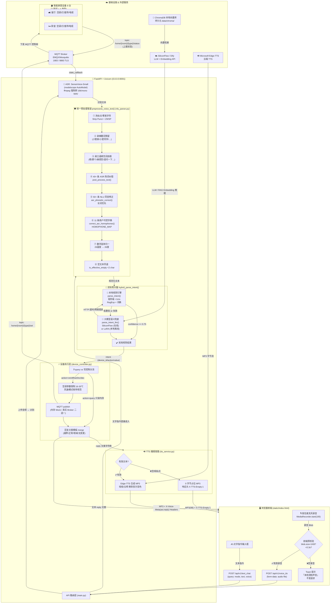

# 智能语音管家 · 全屋互联 (Intelligent Voice Home)

> 基于「**本地规则 NLU + 大模型语义兜底** 双轨制大脑」的端到端智能家居语音控制系统。
> 支持前端麦克风按住说话 → SenseVoice-Small ASR 转写 → 3 级同音/热词纠错 → FastAPI 路由意图 → MQTT 发布控制指令 → Edge-TTS 合成回复语音 → 前端自动播报的 **全链路闭环**；断网/Broker 离线 / LLM 超时 / 空录音等 7+ 种故障场景均有工程化兜底，不给用户弹错误窗口。

---

## ✨ 核心功能亮点

| 模块 | 功能点 | 落地细节 |
|---|---|---|
| 🎙️ **语音/文字双模交互** | 按住麦克风录音 OR 文字框直接输入指令，结果统一回对话气泡 | 前端 [static/index.html](static/index.html) 双 Tab 切换；后端 `/api/v1/voice_tts` 与 `/api/v1/text_chat` 共享同一套 NLU/设备控制链路 |
| 🧠 **双轨制大脑路由（Rule + LLM）** | 95% 高频设备指令走本地正则毫秒级规则，长尾自然语走大模型兜底（本地 LoRA / SiliconFlow 二选一） | `main.hybrid_parse_intent()`：规则 confidence≥0.75 → 直接下发，否则 fallback LLM；LLM 超时 → 再回退规则，保证断网也能控制 |
| 🛡️ **3 级同音/近音词容错** | 三级字典共 **90+ 条**纠错规则，"课听→客厅 / 关调→空调 / 客厅的等→客厅的灯 / 红立→风力"长词优先，解决 ASR WER 1-3% 造成的设备误判 | `preprocess_voice_text()`：洗标点/剥唤醒/剥填充词 → `asr_service.post_process_text` → `asr_phonetic_correct` 50 条 → `correct_asr_homophones` 11 条独立字典 → 数字归一"26温度→26度" |
| 🚀 **空指令早退机制** | `<2 有效字符（纯标点/背景噪音/误触）` 立刻前端 Toast，不进 ASR/LLM，节省 40+ 秒 LoRA 加载与 400+ ms 在线推理 | 前端 `blob.size<1000` 拦截；后端 voice_control 与 `llm_nlu.parse_intent_llm` 顶部双早退，返回 `need_clarification=True, msg=未检测到有效语音指令` |
| 🔌 **MQTT 设备状态感知与控制** | 发布订阅拓扑 + 3 层 topic schema；4 种设备（空调/灯/窗帘/电视）× 2 个房间（卧室/客厅）= 8 台设备全状态同步；Broker 未配置时自动降级为 **内存 Mock 模式**，答辩演示不依赖真实硬件 | `mqtt_client.py`：`home/{room_slug}/{device_type}/set` 下发，`home/+/+/status` 订阅回写内存 `DEVICE_STATES` |
| ❄️ **空调参数钳制 + 越界回复** | 温度硬边界 16-30℃，40℃ 自动 clamp 到 30℃ 并 **明确提示越界**，避免误触硬件保护；风速/模式/扫风 4 个参数强制枚举规范 | `device_controller._execute_ac`：越界→正常→无变更→增减 4 分支回复模板，避免"开着的空调再说开了"的机器人重复回复 |
| 🎙️ **Edge-TTS 语音播报 + 静默降级** | 晓晓/云希 微软生产级音色；空文本/纯标点生成 0 字节占位 MP3 + 响应头 `X-TTS-Empty:1`，前端按 `audioBlob.size<20B` 静默不渲染，彻底消灭「音频文件为空」400 弹窗 | `tts_service.py` 三路 synthesize：`to_file / to_bytes / to_response` 分别带 `[TTS-SAFEGUARD]` 保护分支 |
| 🔎 **设备状态查询 vs 控制分流** | "卧室空调开着吗？"只读内存状态表，**绝不 publish MQTT**，只读路径 confidence 阈值更低；写路径再做 2 层安全闸（action confidence + 设备缺房间澄清） | NLU `action=query` 分支只组装 reply 文案，不下发任何 payload |
| 🧩 **缺设备澄清 + 不对称兜底策略** | 识别到房间但没识别到设备（"把客厅打开"）→ 澄清"未识别到具体设备，要控制客厅的空调/灯/窗帘还是电视？"，**绝对禁止再兜底成客厅空调**；低风险指令（关灯/开窗）才允许"没说房间时默认卧室" | `parse_intent` 早退澄清分支；`hybrid_parse_intent` 新增 `_room_only_missing_device=True` 跳过 resolve_device_id 保护 |
| 🧠 **RAG 知识库问答（可选）** | 家电故障代码表/设备保养指南 md 入库，ChromaDB + SiliconFlow Embedding 语义检索，回答"E1 什么意思/滤网怎么洗"等维修保养问题 | `rag_service.py`：切分 → 批量 Embedding → 存向量库；query 时返回段落距离+来源 |
| 🌦️ **天气服务 + 上下文感知** | 自动获取当天气温，语义触发"我好热"等自然语 → 自动开空调到适宜温度（需要 LLM 模式支持）| `weather_service.py` + NLU 语义信号规则（温度感知/噪音感知/光照感知） |
| 🔁 **复合指令拆分 + 多意图合并** | "客厅窗帘打开、空调开到 26 度、灯关了"一次性拆分执行，每个子意图独立成功/失败回复拼接 | `smart_brain.SmartBrain.route()`：chunking → 并行执行 → reply 合并补位（缺温度时从后段子意图取前子值） |
| 💬 **悬挂意图 + 澄清补全** | "打开空调"（没说房间+温度）→ 悬挂意图 TTL 60 秒 → 用户继续说"卧室 26 度" 自动合并成完整意图下发，不用重复说"帮我把卧室空调开 26 度" | `dialog_context.save_hanging_intent / try_resolve_with_hanging` |
| 🏷️ **Home Assistant REST 兼容层** | 原生提供 `/api/states`、`/api/services/{domain}/{service}` 等 HA 风格 API，可直接对接 HomeKit / HomeAssistant 面板/第三方自动化 | router 中 HA 风格路径与 v1 风格路径双绑定 |
| 🛠️ **Fine-tune 工具链（离线可选）** | 全链路 LoRA 训练脚本：数据构建 → ASR 扰动 → LLM 数据增广 → JSONL → Colab T4 训练 → Ollama 单文件部署 | `finetune/` 独立子目录（见「项目目录结构」） |

---

## 🏗️ 系统端到端架构（Mermaid）



> 数据流说明（完整闭环）：
>
> 1. 用户按住麦克风录音（`MediaRecorder.start(100)` 每 100ms 推一块，彻底修 MediaRecorder.stop() 异步时序导致的 blob.size=0 bug）
> 2. 前端判空 → 有效音频 POST `/api/v1/voice_tts`
> 3. FastAPI 先 ffmpeg → SenseVoice-Small 16kHz 转写
> 4. 经过 8 步统一预处理管道（90+ 条同音词纠正）
> 5. 进入双轨大脑：优先本地规则 → 低置信 fallback LLM → LLM 失败再回退规则
> 6. 执行层：query 只读 DEVICE_STATES；写操作 clamp → MQTT pub → 合并回复文案
> 7. 回复文案走 Edge-TTS 合成 MP3，空文本 → 0 字节占位 + 特殊头
> 8. 前端收到 HTTP 200：文本气泡 + 非空音频 `<audio>` 自动播报

---

## 📁 项目目录结构

```
intelligent_home/
├── 📄 main.py                     # ✨ FastAPI 启动入口：路由注册 / MQTT 生命周期 / 双轨 hybrid_parse_intent / 统一异常处理
├── 📄 config.py                   # 全局配置：SiliconFlow Key/URL、MQTT Broker、LLM 超时、置信度阈值（支持环境变量覆盖）
├── 📄 asr_service.py              # 🎤 ASR 服务：SenseVoice-Small 加载、ffmpeg→16k/mono 转码、40+ 条 HOTWORD_CORRECTIONS 热词纠错
├── 📄 nlu_parser.py               # 🧮 规则 NLU：统一预处理管道 preprocess_voice_text / parse_intent / parse_multi_intent / HOMOPHONE_MAP 11 条 / 悬挂意图 / 澄清分支
├── 📄 llm_nlu.py                  # 🤖 LLM NLU：SiliconFlow(在线) + LLaMA-Factory LoRA(本地离线) 双模式 parse_intent_llm，空文本早退
├── 📄 smart_brain.py              # 🧠 决策大脑：SmartBrain 多意图拆分、合并补温、设备控制轨/闲聊轨/RAG 轨路由合并
├── 📄 dialog_context.py           # 💬 对话上下文：悬挂意图 TTL、多轮澄清补位（用户说「打开空调→再说卧室→再说 26 度」三步并一条指令）
├── 📄 device_controller.py        # ⚡ 设备控制：8 台设备 DEVICE_STATES、空调参数钳制/温度越界回复、query vs 写分流、MQTT 元数据映射
├── 📄 mqtt_client.py              # 🔌 MQTT 客户端：paho-mqtt 真实 Broker 与「内存 Mock 模式」无缝切换；publish/register_state_callback
├── 📄 tts_service.py              # 🔊 TTS 语音合成：Edge-TTS synthesize_file/bytes/response 三路 SAFEGUARD；空文本 0 字节占位
├── 📄 weather_service.py          # 🌦️ 天气服务：HTTP 请求天气 API，给 NLU 温度感知规则做输入
├── 📄 rag_service.py              # 📚 RAG 服务：ChromaDB 向量库、SiliconFlow Embedding、md 知识切分、检索返回段落+距离
├── 📄 router.py                   # 🪢 路由预留：HomeAssistant REST 兼容层抽象
├── 📄 test_nlu.py                 # 🧪 调试脚本（可选保留）：本地跑 parse_intent_llm 单测
├── static/
│   └── 📄 index.html              # 🖥️ 前端单页：DOM 状态面板 + 对话气泡 + MediaRecorder 录音 (start(100)) + 非空音频自动播放
├── data/
│   ├── 📂 chroma/                 # 💽 ChromaDB 持久化向量库（可重建：重启后点「知识库重建」自动生成）
│   │   └── <uuid 目录>/*.bin
│   └── 📂 knowledge/              # 📚 RAG 知识源 Markdown：改这里的 md 再重建就能加新的问答语料
│       ├── 📄 家电故障代码表.md
│       └── 📄 设备保养指南.md
├── 📂 temp_audio/                 # 🎵 运行时 TTS 临时 MP3 缓存（首次自动创建，定期清理无碍）
├── finetune/                      # 🛠️ 【可选】全链路 LoRA 微调工具链：数据构建→增广→训练→部署→评估
│   ├── dataset/
│   │   ├── 01_build_seed_dataset.py   # 生成种子指令集
│   │   ├── 02_perturb_asr.py          # ASR 错误扰动：模拟同音错字/漏字，增强模型鲁棒性
│   │   ├── 03_llm_augment.py          # 调用 LLM 做语义增广（同义改写/换说法）
│   │   └── 04_build_jsonl.py          # 导出 LLaMA-Factory 可直接吃的 JSONL
│   ├── train/
│   │   ├── 📄 dataset_info.json       # LLaMA-Factory 训练数据集 metadata
│   │   └── configs/
│   │       ├── lora_sft_qwen1.5b.yaml # LoRA 超参（Qwen2.5-1.5B SFT）
│   │       ├── eval_sft.yaml          # 评估集配置
│   │       └── export_merge_lora.yaml # LoRA merge + 导出 GGUF
│   ├── eval/
│   │   └── eval_nlu.py                # 离线 benchmark：规则 vs LoRA vs Dify 在同一批指令上的准确率对比
│   ├── outputs/                       # 训练/评估产物（seed_samples / perturbed / llm_augment_samples / eval_nlu_report / nlu_train.jsonl）
│   ├── deploy/
│   │   ├── ollama/
│   │   │   └── Modelfile.template     # Ollama 单文件部署模板（合并 LoRA 后 ollama create）
│   │   └── llm_nlu_local_ollama.py    # Ollama 本地单测脚本（无外网也能跑 LLM 路由）
│   └── scripts/
│       ├── colab_train_t4.md          # Colab T4 训练教程（免费 GPU 跑 1 epoch）
│       └── 01_train_lora_colab_or_gpu.cmd
├── 📄 .env.example               # 🗝️ 环境变量模板：复制为 .env 填 SiliconFlow Key（RAG/在线 LLM 才需要，纯规则模式可以不填）
└── 📄 .gitignore                 # 🔒 忽略：.env / Agent_env venv / temp_tts_*.mp3 / temp_audio / data/chroma
```

---

## 🚀 环境搭建与快速启动

### 1. 环境依赖要求

| 项目 | 最低要求 | 推荐配置 |
|---|---|---|
| **Python 版本** | Python 3.10+ x64 | Python 3.11.9（开发所用版本） |
| **操作系统** | Windows 10/11 x64 或 Linux x86_64 | Windows 11（本项目主开发平台；ffmpeg 在 Linux 需 `apt install ffmpeg`） |
| **硬件：CPU** | Intel i5 四核 12G 内存 | 内存 ≥16GB（SenseVoice-Small + torch 占 ~1.2GB CPU 内存） |
| **硬件：GPU（可选）** | —— | RTX 3060 12G（如果要开本地 LoRA parse_intent_llm(mode=local)；纯规则 NLU 完全不需要 GPU） |
| **浏览器** | Edge 120+ / Chrome 120+ / Firefox 125+ | Edge 最新版（Edge-TTS 音色是微软原生音色，Edge 浏览器最稳） |
| **MQTT Broker（可选）** | 任意 MQTT 3.1.1 兼容 Broker | EMQX 5.x / Mosquitto 2.x（**不装也能跑**，项目会自动降级到内存 Mock，答辩演示零依赖硬件） |
| **ffmpeg（必须）** | ffmpeg 5.0+ 在 PATH | `winget install Gyan.FFmpeg` 或下载静态包丢到 PATH |

### 2. 配置文件说明（config.py + .env）

`config.py` 已实现 **环境变量覆盖默认值**，想改参数有两种等价方式：

- **方式 A（推荐）**：项目根目录创建 `.env`，把下面变量写进去（Python `os.environ.get(..., default)` 会自动读 `.env` 需要配合 `python-dotenv`，或者在启动前 `export/set` 也行）
- **方式 B**：直接改 [config.py](config.py) 里的默认值，简单粗暴

| 变量名 | 默认值 | 说明 |
|---|---|---|
| `SILICONFLOW_API_KEY` | 内置演示 Key（⚠️仅用于本地演示，生产请换自己的）| 硅基流动/云端 LLM API Key，用于在线 NLU + RAG Embedding。注册获取：https://siliconflow.cn/ |
| `SILICONFLOW_BASE_URL` | `https://api.siliconflow.cn/v1` | 一般不改；私有化部署 SiliconFlow 时改到自己的地址 |
| `SILICONFLOW_MODEL` | `Qwen/Qwen2.5-7B-Instruct` | 在线模式使用的模型，推荐 7B；低配电脑可换成 `Qwen/Qwen2.5-1.5B-Instruct` 以降低 API 成本 |
| `RULE_CONFIDENCE_THRESHOLD` | `0.7` | 规则 NLU 置信度阈值：≥0.7 直接用，否则 fallback 到大模型。家里老人口音重可调到 0.55 减少澄清次数 |
| `LLM_TIMEOUT` | `30` | 大模型 HTTP 请求超时秒数，超过就自动回退到规则结果（避免用户卡住 30 秒以上等） |
| `LLM_MAX_RETRIES` | `1` | 大模型 HTTP 失败重试次数；网络不稳定时可以改成 2 |
| `MQTT_ENABLED` | `true` | 设为 `false` → 强制走内存 Mock，不连接任何真实 Broker（答辩演示/无 Broker 机器必备） |
| `MQTT_BROKER_HOST` | `127.0.0.1` | 真实 Broker IP/域名 |
| `MQTT_BROKER_PORT` | `1883` | 真实 Broker 端口；TLS 用 8883（请自改 mqtt_client.py 加 tls set）|
| `MQTT_USERNAME` / `MQTT_PASSWORD` | `""` | Broker 认证用户名密码；空串不启用认证 |
| `MQTT_TOPIC_PREFIX` | `home` | MQTT 主题前缀：下发 `home/bedroom/ac/set`，上报 `home/living_room/light/status` |

### 3. 完整启动步骤（命令行指南）

```bash
# ========== Step 1. 克隆 + 创建虚拟环境 ==========
cd intelligent_home
python -m venv Agent_env
# Windows PowerShell
.\Agent_env\Scripts\Activate.ps1
# Windows CMD
# Agent_env\Scripts\activate.bat
# Linux/macOS
# source Agent_env/bin/activate

# ========== Step 2. 安装依赖 ==========
pip install --upgrade pip
pip install torch --index-url https://download.pytorch.org/whl/cpu      # 纯 CPU 跑 ASR/NLU（没 GPU 就这行）
# 如果有 GPU：pip install torch --index-url https://download.pytorch.org/whl/cu124
pip install fastapi uvicorn pydantic python-multipart httpx aiofiles \
            funasr modelscope transformers peft \
            paho-mqtt edge-tts chromadb imageio-ffmpeg jieba pypinyin \
            numpy scikit-learn python-dotenv

# ========== Step 3. [可选] 配置 MQTT Broker ==========
#   方式 A：跳过（推荐答辩演示）—— MQTT 默认开启但连接失败会自动 Mock，不用装 Broker
#   方式 B：本地起 EMQX（想做真设备对接）
#     winget install emqx
#     emqx start
#     # Web 控制台: http://localhost:18083  (admin/public)

# ========== Step 4. [可选] 配置 API Key ==========
copy .env.example .env
# 用记事本编辑 .env，把 SILICONFLOW_API_KEY 改成你自己的（纯规则模式可不改）

# ========== Step 5. 启动后端 ==========
python main.py
# 看到这几行就 OK：
#   正在初始化 ASR 模型...
#   模型加载完成！
#   LLM 状态: 未配置 (规则模式) / 已就绪
#   [MQTT] 已启动 MQTT 客户端，等待 Broker 连接完成...
#   INFO:     Uvicorn running on http://0.0.0.0:8001

# ========== Step 6. 打开前端 & 开始使用 ==========
# 浏览器打开：
#     本机：  http://localhost:8001/
#     同局域网： http://<你的电脑IP>:8001/   (手机也能控制!)
#
# 操作流程：
#   1. 允许麦克风权限（Edge/Chrome 首次会弹窗）
#   2. 左下角下拉选：
#        - AI 模式：本地规则（稳定、快，纯 CPU 就能跑）/ 本地大模型 / 在线大模型（需要 .env Key）
#        - 语  音：晓晓(女声) / 云希(男声) / etc（Edge-TTS 支持的全部音色，接口 /api/v1/tts_voices 能拿到枚举）
#   3. 按住右下角🎙️麦克风按钮说话：「把客厅的灯打开」「卧室空调调到 26 度」「我好热」
#      松开发送 → 气泡会显示 ASR 识别文本 + 回复文本 + 自动播语音
#   4. 也可以切到「文字」Tab 直接输指令回车
```

---

## 🔗 API 接口说明

> 所有接口基础路径：`http://localhost:8001`。FastAPI 自动生成 Swagger 交互文档：访问 `http://localhost:8001/docs` 直接在浏览器调每个接口做测试（答辩演示超加分）。

### 核心接口速查表

| Method | Path | 功能 | 入参 | 响应 |
|---|---|---|---|---|
| **POST** | `/api/v1/voice_tts` | ✨ **端到端语音控制**（上传录音 → ASR → 意图 → 控制 → TTS MP3 回传） | `multipart/form-data`: `file`(audio blob, `.webm/.wav/.mp3/.m4a/.ogg`)；`query`: `mode`, `voice`, `session_id`, `conversation_id`, `user_id` | `audio/*` MP3 流式响应；自定义响应头：<br>`X-Voice-Meta`（URL encode 过的 `asr=<识别文本>&reply=<回复文案>`）；<br>空文本时 `X-TTS-Empty: 1` |
| **POST** | `/api/v1/text_chat` | 文字指令端到端闭环（文本 → NLU → 控制 → TTS MP3 回传）| `query`: `text`, `mode`, `voice`, `session_id`, `user_id`, `conversation_id` | 同上（语音 MP3 + 头部 meta）|
| **POST** | `/api/v1/voice_control` | 纯设备控制 JSON（只做识别 + 意图 + 下发，不做 TTS；给第三方客户端调用）| `multipart/form-data`: `file` + `query: session_id` | JSON，字段包含 `{code, text, intent, method, confidence, need_clarification, reply, device_state, session_id}` |
| **POST** | `/api/v1/tts` | 纯文本转语音（只跑 TTS，不做 NLU/控制）| `form-data` 或 `query`: `text`, `voice`；可选 `mode` | `audio/mpeg` 流式；空文本时 `X-TTS-Empty: 1` 返回 0B 占位 |
| **GET** | `/api/v1/tts_voices` | 列出 Edge-TTS 当前机器可用的所有音色枚举（含 ShortName/Gender/Locale）| — | JSON 列表，前端下拉框动态渲染 |
| **GET** | `/api/v1/health` | 健康检查（部署用 liveness/readiness probe）| — | `{"status":"ok","asr":"ready"/"pending","mqtt":"ok"/"mock"/"offline"}` |
| **GET** | `/api/v1/ha/states` | HomeAssistant 兼容：列出全部 8 台设备内存状态 | — | JSON 数组（每个 entity_id：entity_id/state/attributes）|
| **GET** | `/api/v1/ha/states/{entity_id}` | 查单台设备状态（例：`/api/v1/ha/states/living_room_ac`）| path: `entity_id` | JSON 单条 state |
| **POST** | `/api/v1/ha/services/{domain}/{service}` | HA 风格服务调用（`domain=light,climate,cover,media_player`；`service=turn_on/turn_off/set_temperature/...`）| path: `domain, service`；body: JSON `{entity_id, ...}` | JSON：调用结果 + 状态列表 |
| **POST** | `/api/v1/ha/smart_control` | ✨ HA 风格自然语单接口（给 HomeKit/HA 面板做对接）| body: JSON `{text, session_id}` | JSON：和 text_chat 同构但不返回 TTS |
| **GET** | `/api/v1/ha/debug` | 调试：dump 内部悬挂意图 + DEVICE_STATES + 会话上下文（开发用）| — | JSON 调试视图 |
| **GET** | `/` | 首页：渲染并返回 `static/index.html` | — | HTML 前端单页 |

### 典型调用示例（命令行 cURL）

```bash
# ========== 1. 文字指令（"把客厅空调调到 26 度"）==========
curl -X POST "http://localhost:8001/api/v1/text_chat?mode=local&voice=xiaoxiao&session_id=demo001&user_id=demo001&text=%E6%8A%8A%E5%AE%A2%E5%8E%85%E7%A9%BA%E8%B0%83%E8%B0%83%E5%88%B0+26+%E5%BA%A6" \
  -o reply.mp3 -D headers.txt
# 读完 headers.txt：X-Voice-Meta 里有 asr= 和 reply=；reply.mp3 就是播报音频
type headers.txt

# ========== 2. 纯文本转 TTS ==========
curl -X POST "http://localhost:8001/api/v1/tts?voice=xiaoxiao" \
  --data-urlencode "text=空调温度范围为 16-30 度，已为您将客厅空调调至最高 30 度。" \
  -o announce.mp3

# ========== 3. 查客厅空调状态 ==========
curl "http://localhost:8001/api/v1/ha/states/living_room_ac"
# 输出：
# {
#   "entity_id": "living_room_ac",
#   "state": "on",
#   "attributes": {"temperature":30, "mode":"cooling", "fan_speed":4, "swing":"vertical", "room":"客厅", "friendly_name":"客厅空调"}
# }
```

---

## 🫶 说明

- **ASR 热词/同音纠错字典可自由扩展**：直接在 [asr_service.py](asr_service.py) 里加 `HOTWORD_CORRECTIONS`（热词级）或 [nlu_parser.py](nlu_parser.py) 加 `_PHONETIC_REPLACE_RULES_UNIQUE`（通用级）或 `HOMOPHONE_MAP`（用户补丁级），三处加完全链路生效，不用改正则。
- **MQTT Topic Schema 扩展新设备**：只要在 [device_controller.py DEVICE_STATES](device_controller.py#L9-L18) 加一条新设备（如 `kitchen_light: {type:light, room:厨房, ...}`），并在 `ROOM_ENG_MAP` 里注册"厨房→kitchen"，Topic `home/kitchen/light/set` 和 status 回写就自动生效，NLU 里设备匹配也会自动识别「厨房的灯」。
- **项目部署到嵌入式 Linux/树莓派路径**：ASR SenseVoice-Small 导出 ONNX + onnxruntime-arm64；TTS 用预合成短语库；MQTT Broker 放云端（4G/WiFi 出口）；LLM 全部走规则。详见答辩备考指南「Q4 边缘部署瓶颈与优化」。

